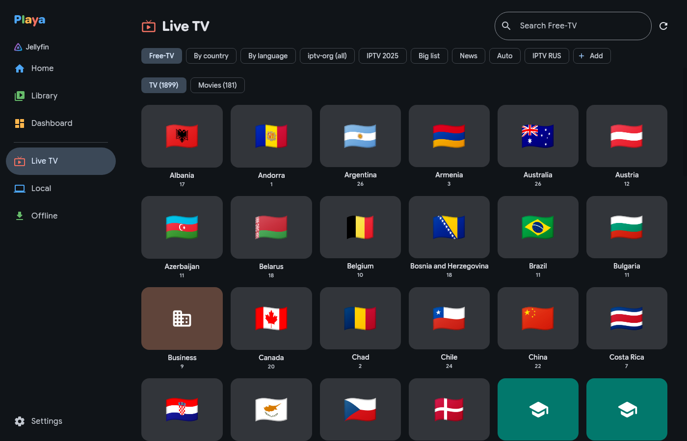

# Playa

A video player for the Ubuntu desktop: your **Jellyfin** server, **live TV** from IPTV playlists, and the **videos on your computer**, in one Material 3 app. Playback is [mpv](https://mpv.io), so it plays nearly anything, at 4K.



- **Jellyfin**: home, libraries, search, resume and "watched" synced with the server, Up next, seek-bar thumbnails, and downloads for watching offline. Admins also get the server dashboard and right-click rescan/refresh.
- **Live TV**: Free-TV, iptv-org and other M3U playlists (or add your own), grouped by country with flags, favourites and recents.
- **Local**: your Videos folder (and any others you add) with thumbnails and resume points. "Open with Playa" works from Files.
- Mini player that stays on top, fullscreen, subtitle and audio track menus, VLC-style keyboard shortcuts.

## Install

Download the `.deb` from [Releases](../../releases/latest), then:

```bash
sudo apt install ./playa_*_amd64.deb
```

`apt` fetches what it needs (libmpv, ffmpeg, zenity, libsecret). Java comes bundled. Tested on Ubuntu 26.04.

## Build

Needs JDK 21 (with `jpackage`) and `libmpv2`.

```bash
./gradlew run                 # run from source
packaging/package.sh          # build/playa_<version>_amd64.deb
```

Built with Kotlin and Compose Multiplatform. Fonts: Google Sans Flex and NeverMind (SIL Open Font License).
